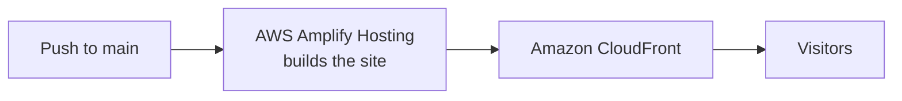

# Asif Hossain — AI Engineer & Researcher

My personal portfolio, covering agentic AI, retrieval systems and research. It is a static website hosted on AWS Amplify.

- **Live site:** [main.d3e5lfymuoo210.amplifyapp.com](https://main.d3e5lfymuoo210.amplifyapp.com/)
- **Personal domain:** [asifhossain.me](https://asifhossain.me/)

Built for the AWS Student Builder Challenge: _Build Your Tech Superpower_ (2026).


## What's on the site

| Section  | What it shows                                                                       |
| -------- | ----------------------------------------------------------------------------------- |
| Home     | Who I am, a 3D animation of an AI agent, and key results                            |
| Work     | AgriBot, Attest and EWU AI Engine with screenshots and results, plus three projects |
| Skills   | Six groups of skills, each linked to the projects that use them                     |
| Ask me   | The creative feature, described below                                               |
| Research | Two accepted IEEE papers, two arXiv preprints and an open model on Hugging Face     |
| About    | Background, education, recognition and certificates                                 |
| Contact  | Email, profiles, and pre-filled emails for common requests                          |


## Creative feature: Ask me

Visitors can ask the portfolio questions about me and my work. I build AI systems that look up information before they answer, and this feature works the same way.

**How to find it:** click **Run the agent demo** on the home page, or **Ask me** in the menu.


Each question goes through five steps, and the steps are shown on screen:

1. **Plan:** the site works out the topic of the question, such as skills, projects or research.
2. **Retrieve:** it searches 19 short documents about my work, using BM25, a standard keyword search method.
3. **Act:** it keeps only the documents that fit the topic. For example, research questions show papers, not projects.
4. **Verify:** it checks whether it found enough information. If not, it replies "I don't have enough evidence for that."
5. **Respond:** it shows an answer based on those documents and suggests what to ask next.

This feature does not use an LLM or any API. It uses keyword search and prewritten answer templates, and it runs in the visitor's browser.

## Hosting



- **AWS Amplify Hosting** connects to this repository and rebuilds the site on every push to `main`. The build steps are in [`amplify.yml`](amplify.yml).
- **Amazon CloudFront** delivers the site to visitors over HTTPS, as part of Amplify Hosting.
- **GitHub Pages** serves the same site at `asifhossain.me`, using [`pages.yml`](.github/workflows/pages.yml).

The site is static, so there is no server or database to run.

## Tech stack

| Area          | Tools                                                       |
| ------------- | ----------------------------------------------------------- |
| UI            | React 19, TypeScript, Vite 7                                |
| 3D and motion | Three.js, React Three Fiber, Motion                         |
| Ask me search | BM25, written in TypeScript in [`agent.ts`](src/agent.ts)   |
| Testing       | Node test runner, Playwright, axe-core accessibility checks |
| Hosting       | AWS Amplify Hosting, Amazon CloudFront, GitHub Pages        |

## Accessibility and mobile

The site works on phones and by keyboard. It also respects the "reduce motion" setting. If a device can't run the 3D scene, a static image replaces it.

<p align="center"></p>

## Run it locally

You need [Node.js](https://nodejs.org/) 22.12 or newer.

```bash
npm ci
npm run dev        # development server at http://localhost:5173
npm run build      # production build in dist/
npm run preview    # serve the production build at http://localhost:4173
```

## Tests

```bash
npm test           # unit tests for the Ask me search
npm run test:e2e   # builds the site, then runs browser tests in Google Chrome
```

## Project structure

```text
src/
  App.tsx          page sections and their content
  AgentScene.tsx   3D animation
  agent.ts         question routing and search for Ask me
  knowledge.ts     the documents Ask me searches
  styles.css       layout and styles
public/assets/img/ portrait, certificates and project images
tests/             browser tests
docs/              images used in this README
```

When you change a project or skill, update both [`App.tsx`](src/App.tsx) and [`knowledge.ts`](src/knowledge.ts) so the page and Ask me stay consistent.

## Contact

[Email](mailto:asifhossain8612@gmail.com) · [LinkedIn](https://www.linkedin.com/in/md-asif-hossain20/) · [GitHub](https://github.com/MdAsif-Hossain) · [Hugging Face](https://huggingface.co/Sabuktagin)
