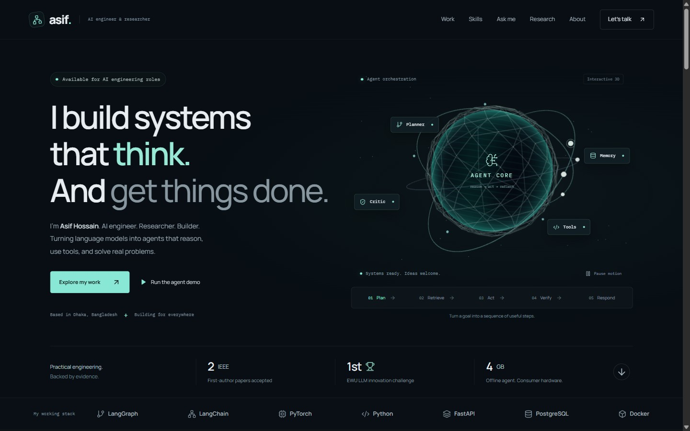
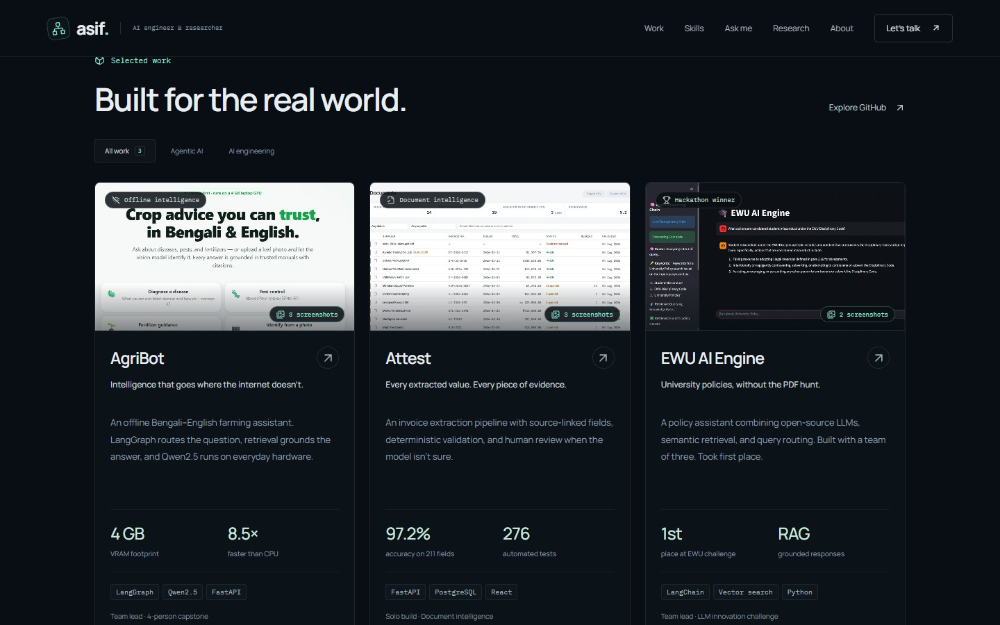
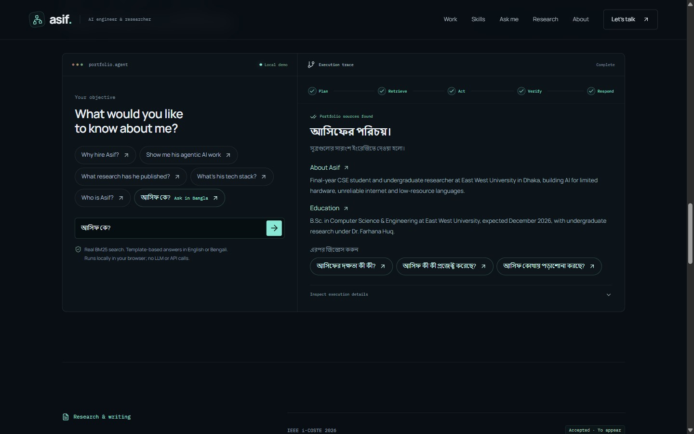
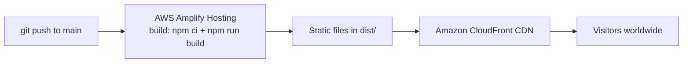
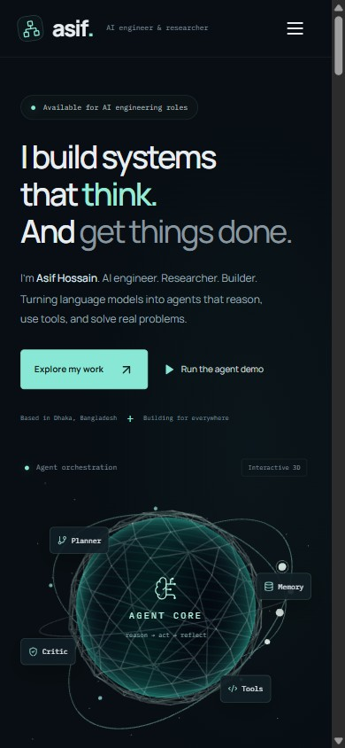

# Asif Hossain — AI Engineer & Researcher

My personal portfolio: agentic AI, retrieval systems and research, presented as a fast, fully static site hosted on **AWS Amplify**.

**Live site:** [main.d3e5lfymuoo210.amplifyapp.com](https://main.d3e5lfymuoo210.amplifyapp.com/)

Built for the AWS Student Builder Challenge: _Build Your Tech Superpower_ (2026).



## What's on the site

| Section      | What you'll find                                                                                 |
| ------------ | ------------------------------------------------------------------------------------------------ |
| **Hero**     | Who I am, an interactive 3D "agent core", and quick proof points                                 |
| **Work**     | AgriBot, Attest and EWU AI Engine with real screenshots and metrics, plus three other projects   |
| **Skills**   | Six groups, from agents and LLMs to data, web and cloud, each tied to the project that proves it |
| **Ask me**   | The creative feature (below)                                                                     |
| **Research** | Two accepted IEEE papers, two arXiv preprints and an open model on Hugging Face                  |
| **About**    | Background, education, recognition and verifiable certificates                                   |
| **Contact**  | Email, profiles, and pre-filled emails for roles, research collaboration or graduate study       |



## Creative feature: ask my portfolio

My work is about agents that find evidence before they answer. So instead of only describing that, the portfolio does it: visitors ask a question and watch a small retrieval workflow answer from the site's own content.

**How to find it:** the **Run the agent demo** button in the hero, or **Ask me** in the navigation.



What happens when you ask:

1. **Plan:** the question is routed to a topic (skills, projects, research, education and so on).
2. **Retrieve:** a BM25 search ranks 20 short documents that describe my projects, papers and background.
3. **Act:** each topic only cites the kinds of document that fit it. For example, research questions cite papers, not projects.
4. **Verify:** if the question isn't covered, it says _"I don't have enough evidence for that"_ instead of guessing.
5. **Respond:** an answer built from the cited sources, plus follow-up questions to ask next.

**What it is not:** this is not an LLM. Everything runs in the visitor's browser with no API calls, no keys and no backend, and the steps are shown so visitors can see exactly what happened. The "Inspect execution details" panel shows the trace for each answer.

## AWS architecture



- **AWS Amplify Hosting** connects to this GitHub repository and rebuilds the site on every push to `main`. The build steps are in [`amplify.yml`](amplify.yml).
- Amplify serves the built files through **Amazon CloudFront**, its global content delivery network, with HTTPS included.
- The site is fully static, so there are no servers, databases or API keys to manage.

### Deploy your own copy

1. Fork this repository.
2. In the AWS Amplify console, choose **Create new app**, then **GitHub**, and select the repository and the `main` branch.
3. Amplify detects `amplify.yml`. Keep the defaults and choose **Save and deploy**.

## Tech stack

| Area          | Tools                                                               |
| ------------- | ------------------------------------------------------------------- |
| UI            | React 19, TypeScript, Vite 7                                        |
| 3D and motion | Three.js, React Three Fiber, Motion                                 |
| Search demo   | BM25 ranking written in TypeScript ([`src/agent.ts`](src/agent.ts)) |
| Testing       | Node test runner, Playwright, axe-core accessibility checks         |
| Hosting       | AWS Amplify Hosting with Amazon CloudFront                          |

<p align="center"></p>

## Run it locally

You need [Node.js](https://nodejs.org/) 22.12 or newer.

```bash
npm ci
npm run dev        # development server at http://localhost:5173
npm run build      # production build in dist/
npm run preview    # serve the production build at http://localhost:4173
```

## Tests

```bash
npm test           # unit tests for search, routing and follow-up questions
npm run test:e2e   # builds the site, then runs browser tests in Google Chrome
```

The browser tests cover navigation, project filters, the screenshot gallery, the ask-me demo, the contact links, mobile widths from 320px to 1440px, visitors without WebGL or with reduced motion, and WCAG 2.1 AA accessibility scans. They use your installed Google Chrome. To use another browser, change `channel` in [`playwright.config.ts`](playwright.config.ts).

## Accessibility and performance

- Works by keyboard, including the gallery (arrow keys and Escape) and the mobile menu.
- The 3D scene loads separately from the rest of the page, pauses when it's off screen or the tab is hidden, and respects the "reduce motion" setting. If WebGL isn't available, a static image takes its place and the rest of the site works as usual.
- Project screenshots are WebP images of 25–70 KB, loaded only when they scroll into view.

## Project structure

```text
src/
  App.tsx          page sections and project, skills and contact content
  AgentScene.tsx   3D agent core
  agent.ts         question routing and BM25 search for the ask-me demo
  knowledge.ts     the documents the demo searches and cites
  styles.css       layout, colors and responsive rules
public/assets/img/ portrait, certificates and project screenshots
tests/             Playwright browser tests
docs/              screenshots used in this README
amplify.yml        AWS Amplify build settings
```

To update content, edit [`src/App.tsx`](src/App.tsx) for what's shown on the page and [`src/knowledge.ts`](src/knowledge.ts) for what the ask-me demo can answer. Keep the two consistent.

## Contact

- Email: [asifhossain8612@gmail.com](mailto:asifhossain8612@gmail.com)
- LinkedIn: [md-asif-hossain20](https://www.linkedin.com/in/md-asif-hossain20/)
- GitHub: [MdAsif-Hossain](https://github.com/MdAsif-Hossain)
- Hugging Face: [Sabuktagin](https://huggingface.co/Sabuktagin)
